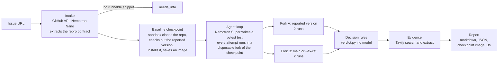

# FixedYet

*Is this bug fixed yet?* **Reproduce before you answer.** Give it a public GitHub issue. An agent writes a pytest test that should fail while the bug is present, runs it in a sandbox at the version the reporter used, runs the same test again on `main`, and returns a verdict with evidence. The sandbox decides the verdict, not the model.

Live demo: **https://benlevin.fyi/fixedyet/** (one run at a time, with a daily limit, because every run costs real compute). It runs on the Docker sandbox backend on a free 1 GB Oracle Cloud VM, so a run takes about 1.5 to 5 minutes.

Built for the Nebius x NVIDIA Global AI Hackathon 2026. MIT licensed.

## Why

Most bug reports get answered from memory, from the docs, or from a model that never ran the code. The questions a maintainer actually needs answered are two:

1. Does the bug exist at the version the reporter used?
2. Is it already fixed on `main`?

FixedYet answers both by running code, and it hands you the sandbox checkpoint so you can see for yourself.

Two design decisions carry the project:

- **Version-anchored.** The reproduction runs at the reported version, then on the fix side. A test that fails on both sides is an open bug. A test that fails at the reported version and passes on `main` is a bug that has already been fixed, and the report names the release when it can.
- **Sandbox-decided.** The model proposes a test. A fixed decision matrix turns the run results into a verdict and a confidence level, and the model cannot override it. Each side runs twice to catch flaky tests, and a test that passes at the reported version is never reported as a reproduction.

## How it works



1. **Intake.** Fetch the issue and its comments through the GitHub API. Nemotron 3 Nano extracts a repro contract: version, setup, snippet, expected and observed behaviour. Nemotron 3 Super is the fallback if Nano returns an invalid contract. No runnable snippet means the run stops with `needs_info`.
2. **Baseline checkpoint.** A sandbox clones the repository, checks out the reported version, installs it, installs the project's own test dependencies (see below), adds the packages the issue asks for with a plain `pip install <name>` (names and version pins only, never URLs or options), and is saved as an image. The test-writing sandbox has no network, so this is the only place a dependency can come from.
3. **Write the test.** A hand-written tool-calling loop (no agent framework) lets Nemotron 3 Super read files, search the code, write a test and run pytest. Each attempt starts from the checkpoint, so failed attempts leave nothing behind.
4. **Run both sides.** Two forks of the checkpoint run the same test, one at the reported version and one on the fix side, twice each.
5. **Decide.** The matrix below gives the verdict. Confidence is high only when every run on both sides agrees and neither side errored.
6. **Evidence.** Tavily searches for duplicates and upstream reports and extracts changelogs to name the release that holds the fix.
7. **Report.** Markdown and JSON, with the checkpoint image IDs needed to rerun every step.

### Decision matrix

| Reported version | Fix side (main) | Verdict |
|---|---|---|
| test fails | test passes | `fixed_on_main` |
| test fails | test fails, same kind of error | `open_bug` |
| test fails | test fails, different error | `inconsistent`, confidence low |
| test passes | test passes | `not_reproduced` |
| test passes | test fails | `inconsistent` |
| setup or collection error, or the environment could not be built | any | `unsupported` |
| the issue has no runnable reproduction | not run | `needs_info` |
| runs disagree on either side | | `inconsistent`, confidence low |

### Where each technology is used

| Technology | Role in FixedYet |
|---|---|
| **Nemotron 3 Super** (`nvidia/nemotron-3-super-120b-a12b`) on Nebius Token Factory | the test-writing loop and the root-cause analysis. Its long context holds the issue thread plus the source files the agent reads |
| **Nemotron 3 Nano** (`nvidia/NVIDIA-Nemotron-3-Nano-30B-A3B`) on Nebius Token Factory | the first pass of intake. A cheap model for a structured extraction, with Super as the fallback |
| **Nebius Token Factory** | OpenAI-compatible inference for both models, through the `openai` client with a per-run budget guard |
| **Nebius Sandboxes** | the intended core primitive. A baseline **checkpoint** is built once per repository and version, and every test attempt and both verdict runs are **forks** of it, since each run starts from an image. The backend is implemented (`sandbox/nebius.py`, on `contree-sdk`) but has **not yet run against the live service**: Sandboxes is in private beta and access was still pending on 2026-10-21. Every result in this README came from the Docker backend, which implements the same checkpoint-and-fork interface (a checkpoint is a committed image) |
| **Tavily** | search for duplicates and upstream reports, and extract for changelogs. This is information the model has never seen |

## Quickstart

Python 3.12 or newer.

```bash
git clone https://github.com/beniamin-levin/fixedyet.git
cd fixedyet
python3.12 -m venv .venv && source .venv/bin/activate
pip install -e .            # add ".[dev]" for the tests

cp .env.example .env        # then fill in the keys, see below
fixedyet doctor            # checks keys, model access and the sandbox
fixedyet run https://github.com/OWNER/REPO/issues/123
```

Keys in `.env` (never committed):

| Variable | Needed for |
|---|---|
| `NEBIUS_API_KEY` | Token Factory inference, and Sandboxes unless `CONTREE_TOKEN` is set |
| `TAVILY_API_KEY` | evidence. Without it that step is skipped |
| `GITHUB_TOKEN` | optional for `run`: a read-only fine-grained token for public repositories, to lift the API rate limit. Without it GitHub allows 60 requests an hour and one run makes about 5 to 8, so a handful of runs empty the hour (a run that hits the limit still finishes, but cannot look up the fixing pull request). Required only for `fixedyet backport --open-pr` and `fixedyet fix --open-pr`, which also fall back to `gh auth token`: see [Verified backports](#verified-backports-draft-prs) for what that token may do |
| `FIXEDYET_SANDBOX` | `nebius` (default) or `docker` for a local Docker daemon |
| `FIXEDYET_KEEP_CHECKPOINTS` | Docker backend only: how many of the newest checkpoint images to keep (default 6) |
| `FIXEDYET_FIX_BUDGET_USD` | [fix mode](#fix-mode-open-bugs-to-verified-draft-prs): the model cost cap of one fix, every attempt included (default 0.25) |

Sandboxes is a beta product, so access may need to be requested from Nebius. The Docker backend runs the same flow on a local daemon.

### Test dependencies

Projects often keep what their tests need outside the package's own extras, and a missing `hypothesis` or `xmlschema` turns a whole test file into a collection error. After the editable install the baseline step therefore reads these from the checkout and installs them, once, into the checkpoint:

- PEP 735 `[dependency-groups]` named `test`, `tests` or `testing` (and the same names in `[tool.pdm.dev-dependencies]`), with `include-group` resolved;
- requirements files: `requirements/test*.txt`, `test-requirements.txt`, `requirements-test.txt`, `tests/requirements.txt` and a few spellings of those;
- a `dev` group or `requirements-dev.txt` only when the project has no test group or file at all, since dev groups tend to hold linters and documentation tools.

A requirements file whose name carries another Python's version (`requirements/tests37.txt`, `test-py38.txt`) is skipped: it is the pin set of a second environment, and installed over the right pins it downgrades them to versions this interpreter cannot import (pallets/jinja 3.1.6 ships `tests.txt` and `tests37.txt`; the second brought trio 0.22.2 to Python 3.13, which broke the `import trio` in the conftest of the main branch).

A group is installed with `pip install --group <name>` when the pip in the image supports it (pip 25.1 and newer; the `python:3.12` image ships an older one), otherwise its entries are read with `tomllib` and installed by name, in one command first and one at a time if that fails. A dependency that cannot be installed is reported in the progress log and never fails the build. Only plain requirements (`name[extras] version-pins ; marker`) are installed: URLs, VCS references, local paths, pip options, an `-r` include or a symlink that leaves the repository, the project's own name and anything past three sources or 120 requirements are refused and counted. The code is `src/fixedyet/testdeps.py`; it runs inside the sandbox with the standard library only and reads the files as text.

### Optional extras, and a conftest that cannot load

Two more steps run in the sandbox with the same helper, after the dependencies and again after the fix side's checkout:

- **Extras of the project itself.** `pip install "python-dotenv[cli]"`, or "with `python-dotenv[cli]` installed", in the thread installs that extra (`pip install -e .[cli]`), and so does a console script of the project that cannot start and tells the reader which extra it wants (`dotenv --help` prints `Run pip install "python-dotenv[cli]"`). Only an extra the project declares is installed, and the agent is told which ones are in.
- **Repair of the conftest.** Pytest collects the test file once before anything runs. If that dies while loading the project's conftest or plugins, the one fixable cause is fixed from the project's own declarations: a missing module (`No module named 'click'`) is installed from the requirement that an extra, group or requirements file of the project lists for it, never guessed from the package index; a package that crashes on import (a stale pin left over from the reported version) is upgraded. At most three rounds, never fatal.

When a run still errors, the report's basis says why (`pytest could not load the project's tests/conftest.py (ModuleNotFoundError: No module named 'click')`), and the test-writing agent is told in the same words that a setup error is not a failure of its test; two in a row end its loop instead of burning the remaining turns.

### Disk use of the Docker backend

Every checkpoint is a local Docker image of about 1.5 GB. After each run FixedYet keeps the newest `FIXEDYET_KEEP_CHECKPOINTS` images of the `fixedyet-ckpt` repository (default 6, so roughly the last three runs) and removes the rest. It never touches an image of another repository, skips an image a container still uses, and when several runs are in flight at once (an evaluation) it waits for the last one. To prune right now:

```bash
fixedyet gc               # keep the newest FIXEDYET_KEEP_CHECKPOINTS images
fixedyet gc --keep 2      # keep two
fixedyet gc --dry-run     # list what would be removed, remove nothing
```

A backport makes two checkpoints (the branch as it was, and with the fix applied) and prunes the same way when it ends. A report's checkpoint image IDs stop resolving once pruning has removed them. Raise `FIXEDYET_KEEP_CHECKPOINTS` if you want to keep more of them.

Useful options:

```bash
fixedyet run URL --fix-ref v2.4.0     # fix side is a tag, branch or commit instead of main
fixedyet run URL --md report.md --json assessment.json
fixedyet backport URL                 # prove the fix on the maintenance branch (dry run)
fixedyet backport URL --open-pr       # ... and open a DRAFT pull request on your fork
fixedyet fix --from-assessment a.json # an open bug: the model writes a fix, the sandbox verifies it
fixedyet serve --port 8090            # the demo web app, on http://127.0.0.1:8090
fixedyet serve --root-path /fixedyet  # the same, behind a proxy that serves it under /fixedyet/
fixedyet mcp                          # the MCP server on stdio
fixedyet gc                           # prune old Docker checkpoint images now
```

## Use it from an AI assistant (MCP)

The MCP server exposes three tools:

| Tool | Returns |
|---|---|
| `reproduce_issue(issue_url, fix_ref=None)` | the markdown report followed by a JSON block with the full assessment |
| `check_fixed(issue_url, ref)` | `{"fixed": true/false/null, "verdict", "confidence", "summary"}` |
| `propose_backport(issue_url, target_branch=None)` | a dry run of [a verified backport](#verified-backports-draft-prs): the markdown summary followed by a JSON block with the result. It never pushes and never opens a pull request |

`fixed` is `true` when the bug reproduces at the reported version and not at `ref`, `false` when it still reproduces at `ref`, and `null` when that cannot be said.

Register it in Claude Code:

```bash
claude mcp add fixedyet -- /path/to/fixedyet/.venv/bin/fixedyet mcp
```

Or in any MCP client with a stdio entry:

```json
{
  "mcpServers": {
    "fixedyet": {
      "command": "/path/to/fixedyet/.venv/bin/fixedyet",
      "args": ["mcp"],
      "env": { "NEBIUS_API_KEY": "...", "TAVILY_API_KEY": "..." }
    }
  }
}
```

A run takes a few minutes and spends credits, so the assistant should call it on purpose.

## Verified backports (draft PRs)

A bug that is fixed on `main` is still broken for everyone on the release they use. When a run ends `fixed_on_main` and the fixing commit is known, `fixedyet backport` prepares that fix for the **maintenance branch of the reported version** and proves it there, so that a maintainer reviews a tested patch instead of a promise.

```bash
fixedyet backport https://github.com/OWNER/REPO/issues/123            # reproduce, then backport (dry run)
fixedyet backport URL --from-assessment assessment.json              # reuse a saved run: no model calls
fixedyet backport URL --target-branch 8.1.x --json r.json --md r.md  # choose the branch, save the result
fixedyet backport URL --open-pr                                      # also open a DRAFT pull request on your fork
fixedyet backport URL --open-pr --pr-target upstream                 # ... on the upstream project (asks first)
```

A real case, end to end (`fixedyet run`, then `fixedyet backport --open-pr`, Docker sandbox): [pytest-dev/pytest#13784](https://github.com/pytest-dev/pytest/issues/13784), where `capteesys` printed everything twice under `-s` on pytest 8.4.1. The fix was merged to `main` after the `8.4.x` branch was cut and never backported. FixedYet found `8.4.x`, cherry-picked the fix without conflicts, showed the reproduction test failing before and passing after, and showed the project's suite (about 3,250 tests) with no new failure. The draft pull request is [in the owner's fork](https://github.com/beniamin-levin/pytest/pull/1), not in the upstream project. The saved result is `examples/real-backport-pytest-dev-pytest-13784.json` and appears on the demo page.

Without `--open-pr` nothing leaves your machine except the sandbox's own clone of the public repository. The command prints a markdown summary and exits 0 only for a verified backport.

### The gates

Each gate runs in the sandbox, from a fresh checkout of the head of the target branch. The model is not involved after the reproduction: a backport costs sandbox time, not tokens.

1. **Find the branch.** From the repository's branch names (`git ls-remote --heads`): `8.1.x`, `v8.1.x`, `8.1`, `stable/8.1`, `release-8.1`, `maint/8.1`, `8.1-maintenance` and similar match a reported `8.1.3`. A line for another minor (`8.2.x`) never matches, and an unversioned `stable` is not guessed at; use `--target-branch` for those. No branch means `not_applicable`, with the reason and the branches that were seen.
2. **The reproduction test must fail on the branch.** If it passes, the branch already has the fix (`already_fixed_on_branch`). If it errors or flips between runs, nothing can be judged (`error`).
3. **`git cherry-pick -x <fixing commit>`**, with `-m 1` for a merge commit. A fix whose commit is unknown (a squashed pull request that could not be traced) is reported as such.
4. **Conflicts stop it.** The pick is aborted and the conflicting files are listed (`conflicts`). The model never resolves conflicts: a resolved conflict is new code that nobody has reviewed.
5. **Reinstall, and the reproduction test must pass.** If it still fails, the fix depends on other changes the branch does not have (`error`).
6. **The project's own test suite, before and after** (pytest, every test, no `-x`, 900 s each, no network). A test that fails after the cherry-pick and did not fail before is a `regression`. Tests that already failed on the branch are the baseline and are not blamed on the patch. If the suite cannot run (timeout, collection crash) the backport cannot be called verified (`error`), and the patch is attached unverified.
7. **`git format-patch`** of the cherry-pick is the result's `patch`.

| Status | Meaning |
|---|---|
| `verified` | the test fails before and passes after, and no test newly fails |
| `conflicts` | the cherry-pick does not apply; files listed, nothing resolved |
| `regression` | the fix works but newly breaks other tests; they are named |
| `already_fixed_on_branch` | the branch passes the reproduction test already |
| `not_applicable` | not fixed on main, no known fixing commit, or no branch for that version |
| `error` | a step could not be completed; the reason says which |

The result (`BackportResult`) also carries the cherry-picked commit message, the reproduction test's outcomes before and after, the suite counts and failing test ids before and after, log excerpts, cost and wall time. When one is attached to an assessment, the markdown report gains a "Verified backport" section.

### The draft pull request

`--open-pr` works only on a `verified` result, and only as the owner of the token (`GITHUB_TOKEN`, or `gh auth token` when that is empty):

1. fork the upstream repository into the token's account if there is no fork yet, and wait for it;
2. on the host, apply the sandbox's patch to a throwaway clone of the verified base commit and push the branch `fixedyet/backport-<issue number>-<target branch>` to the **fork**, over HTTPS. Only git runs on the host (`fetch`, `am`, `push`, with hooks off): project code never does;
3. open a **draft** pull request titled `Backport <short summary of fix> to <target branch>`. The body links the issue and the original commit, tabulates the reproduction test before and after the cherry-pick, gives the suite results and a patch summary.

Where the pull request goes:

| `--pr-target` | Base of the pull request |
|---|---|
| `fork` (default) | the fork's own copy of the maintenance branch. Nothing reaches the upstream project |
| `upstream` | the upstream maintenance branch. FixedYet asks you to type the repository name first (skipped by `--yes-upstream`), before any sandbox work starts |

What it never does: mark a pull request ready for review, comment on the upstream issue or pull request, push to the upstream repository, force-push (a rerun finds the open pull request and returns it instead of opening a second one), or print the token (it travels in a request header and in the environment of one git process, never in a URL or on a command line, and error messages are scrubbed of it).

Every pull request body ends with this line, which cannot be turned off:

> Prepared with FixedYet (AI-assisted: NVIDIA Nemotron via Nebius Token Factory); reviewed and submitted by @&lt;token owner login&gt;.

The line says the pull request was prepared with AI, and that a named person is responsible for it. Read the patch before you submit one: a green suite is evidence, not a review.

The token needs to create a fork, push to it and open pull requests: a fine-grained token with *Contents* and *Pull requests* write access on the fork (plus the permission to fork), or a classic token with `public_repo`.

### Limits

- Pytest projects that install with pip, like the rest of FixedYet. Test dependencies come from [the groups and files listed above](#test-dependencies); a project whose tests need anything else (a service, a system library, a tox-only dependency list) cannot be fully verified, and its missing tests sit in the baseline.
- The suite runs without network, so a test that needs one fails before and after alike and sits in the baseline. A test that is flaky can still be reported as a regression; the failing ids are listed so that you can see.
- Projects that keep one rolling branch (`stable`) instead of one branch per minor release give `not_applicable` unless you pass `--target-branch`. `pallets/click` is such a project at the time of writing.

## Fix mode: open bugs to verified draft PRs

When the verdict is `open_bug`, the reproduction test fails on `main` too: the bug is real and nobody has fixed it yet. `fixedyet fix` asks Nemotron 3 Super for the smallest change that makes that test pass, and accepts nothing it has not proved in the sandbox.

```bash
fixedyet fix --from-assessment assessment.json                  # an open_bug run saved with --json
fixedyet fix https://github.com/OWNER/REPO/issues/123           # reproduce first, then fix
fixedyet fix --from-assessment a.json --json r.json --md r.md --pr-preview pr.md   # save it all
fixedyet fix --from-assessment a.json --open-pr                 # ... and a DRAFT PR on your fork
fixedyet fix --from-assessment a.json --open-pr --pr-target upstream   # ... on the project (asks)
```

1. **Base.** The head of the project's default branch, found with `git ls-remote`, is built in the sandbox and pinned by commit.
2. **The test must fail there, twice.** It runs at the path the pull request will add it (`tests/test_issue_<n>.py`, or the repository's `test/` or `testing/` directory), so what is verified is what would ship. A test that passes means `already_fixed`; one that errors or flips means `error`.
3. **Localize.** The model sees at most 4 of the project's source files and about 60 KB: the project's own frames in the failing traceback first, then files the issue names, then the files that mention the issue's distinctive names most and the files that define what the test imports. The distinctive names are the tests and filters a template applies after `is` or `|`, words in the issue's code spans, CamelCase, CONSTANT_CASE and snake_case names, and quoted words, never the test's own variables. `git grep` in the sandbox counts them in every source file; rare names, many different names and registry entries such as `"escaped": test_escaped` weigh most. A module called `tests.py` inside the package is source like any other; the top-level `tests/` directory is not. A big file is sent as windows (the functions around those lines) with an outline. The model may ask once, at any point, for up to 3 more files, and a file it edits without having seen it, or where its SEARCH block matches nothing, is shown to it in the next round.
4. **Edits, not diffs.** The answer is search/replace blocks: a file, an exact old block, a new block. On the host, as text, each old block must occur exactly once (a block that only differs by a uniform re-indentation still counts once); only existing `.py` source files may change, never a test, CI, packaging or configuration file, and never a new file; at most 80 changed lines; the file must still parse. Anything else is refused with the reason, and with the closest lines when a block matches nowhere.
5. **Verify in the sandbox.** The edited files are written over the checkout, `git diff` makes the patch, and the test must pass twice. Then the project's own suite runs without the change (once) and with it, 900 s each, no network: nothing may newly fail. The model's code never runs on the host.
6. **Iterate.** Up to 3 attempts. A failed one goes back to the model: the rejected edits and why (with the format, the caps and "the smallest change that fixes the root cause" restated), or the diff with the test output, or the newly failing tests with the end of the suite log. Every attempt starts from the original code. The model may also answer that the test itself is wrong (`CANNOT_FIX`), which ends the fix with nothing changed. `FIXEDYET_FIX_BUDGET_USD` (default $0.25) caps the model cost of the whole fix.

| Status | Meaning |
|---|---|
| `verified` | the test fails twice without the change and passes twice with it; the suite has no newly failing test |
| `not_fixed` | no attempt passed; every attempt and its reason are in the result |
| `already_fixed` | the test passes on the default branch now |
| `not_applicable` | not an open bug, no reproduction test, or not a GitHub issue |
| `error` | a step could not run (the build, the suite on the default branch); the reason says which |

The result (`FixResult`) holds the attempts, the verified diff, the test and suite tables before and after, the model's one-line summary and its explanation (marked as unchecked text), cost and time. `--open-pr` works only on `verified` and uses the backport's machinery: the branch `fixedyet/fix-<issue>` is pushed to your fork with the change and the regression test, authored by you, and a **draft** pull request is opened against the default branch (your fork's copy by default, the upstream project only after you type its name). The body starts with `Fixes #<n>`, says plainly that the change was written by an AI model and verified by machine, gives the tables, the patch summary and the regression test, and ends with the same disclosure line as a backport. When the repository has no `tests/`, `test/` or `testing/` directory the test is left out of the pull request and the body says so.

### Live results

Six live runs on 21 October 2026, on four `open_bug` reports from the demo, all on the **local Docker backend** with Nemotron 3 Super through Token Factory (the Nebius Sandboxes backend is implemented but has not run a fix live). No pull request was opened: the previews are for review.

| Issue | Result | Attempts | Change | Project suite without / with | Model cost | Time |
|---|---|---|---|---|---|---|
| [pallets/jinja#2244](https://github.com/pallets/jinja/issues/2244) | **verified** | 1 (after one request for `tests.py` and `runtime.py`) | `src/jinja2/runtime.py`: removes `ChainableUndefined.__html__` (3 lines) | 911 passed / 911 passed | $0.016 | 80 s |
| [marshmallow-code/marshmallow#3072](https://github.com/marshmallow-code/marshmallow/issues/3072) | **verified** (second run) | 1 | `src/marshmallow/validate.py`: `(?!-)` and `(?<!-)` around the last label of `Email.DOMAIN_REGEX` (+1 / -1) | 1192 passed / 1192 passed | $0.007 | 35 s |
| marshmallow#3072, first run | not fixed | 3, all rejected | the model repeated an edit and dropped a quote when copying; this led to the repeat, re-indent and closest-lines handling | - | $0.020 | 69 s |
| [dateutil/dateutil#1588](https://github.com/dateutil/dateutil/issues/1588) | not fixed (two runs) | 3 + 3 | run 1: an `and`/`or` precedence slip broke 115 tests, then logic that kept the intersection, then alternatives for one place; run 2: a block that is not in the file, then the same unbalanced bracket twice | 5044 passed, 3 failed (run 1's baseline; run 2 never reached the suite) | $0.031 + $0.023 | 241 s + 94 s |
| [pyparsing/pyparsing#693](https://github.com/pyparsing/pyparsing/issues/693) | stopped | 2 of 3 | two answers ran out of tokens on reasoning (then a 12k limit and a 180 s timeout, since raised to 16k and 420 s); stopped by hand during the third | - | about $0.026 | 7+ min |

Read these as a maintainer would. The marshmallow change is exactly the fix the issue proposes, and it touches the root cause. The jinja change removes the method that makes an undefined value look escaped. `ChainableUndefined.__html__` was added in 2019 to fix `Markup()` on a chainable undefined; the class's `__getattr__` now raises `AttributeError` for dunder names, so the method looks redundant, and a manual container check after the run agrees (`Markup()`, `escape()` and autoescaped output are still empty without it). The suite has no direct test of that case, though, and the open upstream pull request for the issue changes the `escaped` test instead; both are defensible, and the choice is the maintainers'. Every one of these four issues already had an open upstream pull request when the runs were made (jinja #2259, marshmallow #3073, dateutil #1589, pyparsing #694), so neither verified fix should be opened as a competing pull request without talking to the maintainers first. The pyparsing report is a lesson for the triage step: its test compares a `ParseResults` object with a list, which is never equal, and on `master` the parsed value is already `[['x']]`; there is no source bug to fix there, and the right answer from fix mode would have been `CANNOT_FIX`.

### Limits

- A verified fix is a fix that the model's own test accepts and the project's suite does not reject. That is evidence, not a review: the test can be too narrow and the suite can miss things. Read the diff as you would a stranger's pull request.
- The model sees a few files, not the whole project. A fix that needs a change in code it was not shown can only be reached through its one request for more files.
- An open bug often has a pull request already. Look at the issue's linked pull requests before you open another.

## Web demo

https://benlevin.fyi/fixedyet/ runs the same pipeline behind a small FastAPI app: paste an issue URL, watch the stages live, read the report with the two-sided result and the test. The server runs one issue at a time and stops at a daily limit (`FIXEDYET_DEMO_DAILY_LIMIT`), then points visitors at saved example reports.

Run it locally with `fixedyet serve`. The page uses only relative URLs, so it works at the root of a host and under a prefix: behind nginx's `location /fixedyet/ { proxy_pass http://127.0.0.1:8090/; }` (which strips the prefix), start it with `--root-path /fixedyet` or `FIXEDYET_ROOT_PATH=/fixedyet` so redirects carry the prefix. Deployment files for a small Ubuntu VM (nginx, systemd, a deploy script) are in [`deploy/`](deploy/README.md).

The **All reports** page (`/reports`, linked from the header) lists every example and every finished run in the runs directory, newest first, with chips for All / Fixed on main / Open bug / Not reproduced / Other and a search by repository or title. A report opens at `reports#<id>`, which can be shared. On a report that is fixed on main with a known fixing commit, the **Backport fix → draft PR** button tells a visitor that opening pull requests on the demo is limited to its maintainer, and shows the commands to run it themselves (`fixedyet backport <issue URL> --open-pr`, and with `--pr-target upstream` for the upstream project) with a link to the verified example. Setting `FIXEDYET_ADMIN_TOKEN` turns on maintainer mode: after signing in (the small "Maintainer sign-in" link at the bottom of the page) the owner works in two steps. **Verify backport** runs the cherry-pick, the reproduction test and the project's suite on the server and opens no pull request; the card then shows the facts, the patch to review, and a warning when the target branch looks inactive (no commit for 180 days, or a newer release line). A second request then opens a draft pull request in the owner's own fork, or on the upstream project after the owner types its name. On an open bug the maintainer gets **Attempt a fix** instead ([fix mode](#fix-mode-open-bugs-to-verified-draft-prs)): the same progress log, then the verified diff (light, with red and green line tints) and the same two pull request buttons; visitors see a note that only the maintainer can run it. The owner can also hide a report. Without the token every maintainer endpoint answers 404. See [`deploy/README.md`](deploy/README.md#maintainer-mode).

The reports in [`examples/`](examples) are saved output of real runs on real GitHub issues (Docker sandbox backend, Nemotron 3 Super through Token Factory). Each file names the issue it ran on, and the page marks them as real runs. A saved `fixedyet backport --json` result in that folder (`real-backport-<owner>-<repo>-<number>.json` and `.md`) is listed and drawn as a backport report.

## Evaluation

The claim "reproduce before you answer" is only worth something if it is measured. The evaluation uses SWE-bench Verified: the base commit plays the reported version, the base commit plus the gold patch plays `main`, and the agent never sees the patch or SWE-bench's own tests. An instance counts as reproduced when the agent's own test fails at the base commit and passes with the patch, in every run.

**Measured on 2026-10-21: 12 of 15 instances reproduced in one full run and 10 of 15 in the other** (80% and 67%; 95% intervals 55-93% and 42-85%). The 15 instances (`eval/instances.txt`) come from light pure-Python projects (requests, pytest, pylint, Flask) whose fixing pull requests date from 2014 to 2023. Both runs used the same code (commit `348a63f`), Nemotron 3 Super with Nemotron 3 Nano for intake, and a **local Docker sandbox** (Colima on an Apple-silicon Mac). The live demo uses the same Docker backend on a 1 GB Oracle Cloud VM.

| Metric | Run A | Run B |
|---|---|---|
| Reproduction rate (`fixed_on_main`) | 12/15 (80.0%) | 10/15 (66.7%) |
| Wrong open-bug rate (`open_bug`) | 3/15 (20.0%) | 4/15 (26.7%) |
| Not reproduced rate | 0/15 (0.0%) | 0/15 (0.0%) |
| Inconsistent rate | 0/15 (0.0%) | 0/15 (0.0%) |
| Setup failure rate (`unsupported`) | 0/15 (0.0%) | 1/15 (6.7%) |
| Needs-info rate | 0/15 (0.0%) | 0/15 (0.0%) |
| Mean cost per issue | $0.031 | $0.031 |
| Median cost per issue | $0.025 | $0.022 |
| Mean wall time per issue | 1m24s | 1m33s |
| Total cost of the run | $0.47 | $0.46 |

What went wrong, plainly: **the misses are the model's tests, not the environment.** In 3 instances (pytest-7432, pylint-4970, pylint-6528) the test fails on both sides in both runs, so FixedYet would have called a fixed bug still open (the "wrong open-bug" rate); requests-2317 and pylint-4604 each missed once. Each time the test asked for more than the fix delivers, had a wrong expectation or called an API that does not exist. The one "setup failure" in run B is that last kind: a test naming a class that does not exist. All 15 environments built in both runs, after the harness fixes the development runs found (listed in the evaluation page).

What the numbers do not say:

- **Contamination.** Nemotron may have seen these public issues and their fixes during training, and several reproduced tests are the issue's own snippet. The score partly measures recall. The live check on open issues, which have no public fix, is **not done yet**.
- **Small sample, noisy model.** One instance is 6.7 points, and the two runs differ by two instances.
- **`fixed_on_main` is necessary, not sufficient.** I read all 22 reproduced tests against their issues; that audit was done by an AI (Claude), not a person, and found a few weaknesses (one test calls a live server). A person has not audited them.

The per-instance verdicts, costs and failure causes, the metric definitions, the audit and how to rerun are in [`docs/evaluation.md`](docs/evaluation.md). The raw results are in `eval/results/`.

## Cost per issue

Measured: **$0.031 on average and $0.024 at the median** per issue at Token Factory list prices (30 instance runs on SWE-bench, most expensive $0.076), and no Tavily credits because eval mode skips web evidence. A live run on a GitHub issue adds the evidence step, so expect a few Tavily credits on top. That is three to ten times below the earlier estimate of $0.10 to $0.30, which assumed up to 20 agent turns over a growing context; the real runs averaged 15 model calls.

Nemotron 3 Super costs $0.30 per million input tokens and $0.90 per million output tokens, and Nano costs $0.06 and $0.24. A run is input-heavy: on average about 90,000 input and 5,000 output tokens. A hard cap stops any run that goes past `FIXEDYET_RUN_BUDGET_USD` (default $0.60), and the run then ends without a verdict rather than guessing.

Token Factory has no spending limit and charges the card when the balance goes negative, so a second cap lives in the code: `FIXEDYET_TOTAL_BUDGET_USD` (default $20) limits the model spend of **all runs ever**. Every chat call is first checked against a spend ledger, `runs/spend-ledger.json`: if the total so far plus the worst-case cost of the call would pass the cap, the call is refused before it is sent and the run ends as `unsupported` with "total budget reached" in its basis. The web demo answers 429 once less than one run's budget is left, and `fixedyet doctor` prints the total and what remains. To raise the cap, raise the variable; to start counting again, delete the ledger file only after checking the real balance.

Fix mode has its own cap per fix, `FIXEDYET_FIX_BUDGET_USD` (default $0.25, every attempt included), and its calls go through the same ledger. The six live fix runs cost $0.007 to $0.031 each in model spend ($0.12 together).

## Limitations

- **Pure-Python projects that test with pytest.** That is what the environment builder installs and what the verdict runs.
- **No services or databases.** An issue that needs a running database, a message broker or a browser is reported as `unsupported`, not guessed at.
- **Old versions can fail to install.** Rebuilding a years-old release is the hardest part of the problem. Setup failures are their own verdict and their own metric.
- **A failing test is not proof of the reported bug.** The model can write a test that fails for another reason. The two-sided rule, two runs per side and the `inconsistent` verdict reduce this, but a person should still read the test. The evaluation audits the reproduced tests for exactly this.
- **Training contamination.** Nemotron may have seen SWE-bench issues and their fixes during training. The evaluation says so, and live runs on open issues are the check against it.
- **Sandboxes is in beta,** with limits on concurrent operations and run time.

## Prior art and how this differs

- **Metabase Repro-Bot** (open source, MIT) is the closest relative. It checks a bug at the reported version and on `master` and reports that it is fixed. It works only on Metabase, lets the model decide the verdict, forbids web search in its prompt and runs inside Claude Code. FixedYet is generic across pure-Python projects, lets rules decide, and adds web evidence.
- **SWE-agent, mini-swe-agent, OpenHands** and the commercial coding agents go straight to a fix. Reproduction is at most a step inside their prompts, never an output. FixedYet's main output is the proof. Its fix mode is deliberately narrower than those agents: only for a bug the sandbox has already shown to be open, at most 80 changed lines, never a test or packaging file, and nothing is called a fix until the reproduction test flips and the project's suite has no new failure.
- **The OpenAI, Vercel and Daytona reference agents** for issue triage run code against the default branch only. They do not pin the reported version and they let the model judge the result.
- **Label-and-answer triage bots** work from documentation and code search without running anything.

As of a market check on 21 October 2026, to our knowledge no tool combines a pinned reported version with a second run on the fix side, a rule-based verdict, web evidence and a published success rate and cost per issue. The last part depends on the evaluation above.

## Safety

- **Issue text and web content are untrusted data.** The model is told so, snippets are only ever run inside a sandbox, and nothing from an issue is run on the host.
- **Code runs only in sandboxes.** The host process never executes code from an issue, and never runs code the model wrote: fix mode validates the model's edits on the host as text (and parses them with `ast`, which runs nothing), then applies and tests them only in the sandbox, without network.
- **It never posts to other people's repositories by default.** The GitHub client only reads. Reports go to a file, to the terminal or to the demo page, so no labels or comments are created. The write paths are `fixedyet backport --open-pr`, `fixedyet fix --open-pr` and the demo's maintainer-only backport and fix buttons: all push to the token owner's own fork and open a *draft* pull request, and none comments on an issue. Both can target the upstream project instead, only after the person types the repository's name: the command line asks for it, and the web page's maintainer types it before the request is sent ([details](#verified-backports-draft-prs)).
- **Secrets stay in the environment.** They are read from `.env` or the process environment, masked when settings are printed, and never returned by the web API or the MCP server. Web errors are short messages, never stack traces.
- **The demo is rate limited,** to one run at a time and a daily total, so it cannot be used to spend the owner's credits without limit.

## Project layout

```
src/fixedyet/
  pipeline.py      reproduce(): the whole flow
  agent.py         the hand-written tool-calling loop
  verdict.py       the decision matrix (pure function)
  envbuild.py      baseline checkpoint and per-side runs
  testdeps.py      installs a project's test dependency groups and requirements files (runs in the sandbox)
  sandbox/         Nebius Sandboxes and Docker backends
  evidence.py      Tavily search and extract
  report.py        markdown rendering
  backport.py      verified backports: branch detection, cherry-pick and suite gates in the sandbox
  fixmode.py       fix mode for open bugs: localize, model edits, validation, sandbox verification
  pullrequest.py   fork, push from the sandbox result, draft pull request (only with --open-pr)
  web/             the FastAPI demo, the reports page and its static files
  mcp_server.py    the MCP server
  eval/            the SWE-bench loader and runner
deploy/            nginx, systemd and deploy script for the demo
examples/          saved reports of real runs, shown on the demo page
docs/              architecture, design, evaluation
```

Development: `pip install -e ".[dev]"`, then `python -m pytest` and `ruff check src tests`. Tests never call a paid API.

## Licence

MIT, see [LICENSE](LICENSE).

Built for the Nebius x NVIDIA Global AI Hackathon 2026.
