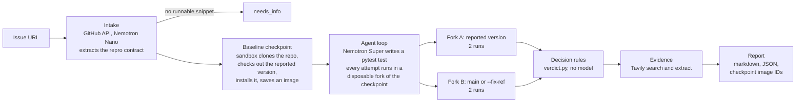

# FixedYet

*Is this bug fixed yet?* **Reproduce before you answer.** Give it a public GitHub issue. An agent writes a pytest test that should fail while the bug is present, runs it in a microVM sandbox at the version the reporter used, runs the same test again on `main`, and returns a verdict with evidence. The sandbox decides the verdict, not the model.

Live demo: **https://benlevin.fyi/fixedyet/** (one run at a time, with a daily limit, because every run costs real compute)

Built for the Nebius x NVIDIA Global AI Hackathon 2026. MIT licensed.

## Why

Most bug reports get answered from memory, from the docs, or from a model that never ran the code. The questions a maintainer actually needs answered are two:

1. Does the bug exist at the version the reporter used?
2. Is it already fixed on `main`?

FixedYet answers both by running code, and it hands you the sandbox checkpoint so you can see for yourself.

Two design decisions carry the project:

- **Version-anchored.** The reproduction runs at the reported version, then on the fix side. A test that fails on both sides is an open bug. A test that fails at the reported version and passes on `main` is a bug that has already been fixed, and the report names the release when it can.
- **Sandbox-decided.** The model proposes a test. A fixed decision matrix turns the run results into a verdict and a confidence level, and the model cannot override it. Each side runs twice to catch flaky tests, and a test that passes at the reported version is never reported as a reproduction.

## How it works



1. **Intake.** Fetch the issue and its comments through the GitHub API. Nemotron 3 Nano extracts a repro contract: version, setup, snippet, expected and observed behaviour. Nemotron 3 Super is the fallback if Nano returns an invalid contract. No runnable snippet means the run stops with `needs_info`.
2. **Baseline checkpoint.** A sandbox clones the repository, checks out the reported version, installs it, adds the packages the issue asks for with a plain `pip install <name>` (names and version pins only, never URLs or options), and is saved as an image. The test-writing sandbox has no network, so this is the only place a dependency can come from.
3. **Write the test.** A hand-written tool-calling loop (no agent framework) lets Nemotron 3 Super read files, search the code, write a test and run pytest. Each attempt starts from the checkpoint, so failed attempts leave nothing behind.
4. **Run both sides.** Two forks of the checkpoint run the same test, one at the reported version and one on the fix side, twice each.
5. **Decide.** The matrix below gives the verdict. Confidence is high only when every run on both sides agrees and neither side errored.
6. **Evidence.** Tavily searches for duplicates and upstream reports and extracts changelogs to name the release that holds the fix.
7. **Report.** Markdown and JSON, with the checkpoint image IDs needed to rerun every step.

### Decision matrix

| Reported version | Fix side (main) | Verdict |
|---|---|---|
| test fails | test passes | `fixed_on_main` |
| test fails | test fails, same kind of error | `open_bug` |
| test fails | test fails, different error | `inconsistent`, confidence low |
| test passes | test passes | `not_reproduced` |
| test passes | test fails | `inconsistent` |
| setup or collection error, or the environment could not be built | any | `unsupported` |
| the issue has no runnable reproduction | not run | `needs_info` |
| runs disagree on either side | | `inconsistent`, confidence low |

### Where each technology is used

| Technology | Role in FixedYet |
|---|---|
| **Nemotron 3 Super** (`nvidia/nemotron-3-super-120b-a12b`) on Nebius Token Factory | the test-writing loop and the root-cause analysis. Its long context holds the issue thread plus the source files the agent reads |
| **Nemotron 3 Nano** (`nvidia/NVIDIA-Nemotron-3-Nano-30B-A3B`) on Nebius Token Factory | the first pass of intake. A cheap model for a structured extraction, with Super as the fallback |
| **Nebius Token Factory** | OpenAI-compatible inference for both models, through the `openai` client with a per-run budget guard |
| **Nebius Sandboxes** | the core primitive. A baseline **checkpoint** is built once per repository and version, and every test attempt and both verdict runs are **forks** of it, since each run starts from an image |
| **Tavily** | search for duplicates and upstream reports, and extract for changelogs. This is information the model has never seen |

## Quickstart

Python 3.12 or newer.

```bash
git clone https://github.com/beniamin-levin/fixedyet.git
cd fixedyet
python3.12 -m venv .venv && source .venv/bin/activate
pip install -e .            # add ".[dev]" for the tests

cp .env.example .env        # then fill in the keys, see below
fixedyet doctor            # checks keys, model access and the sandbox
fixedyet run https://github.com/OWNER/REPO/issues/123
```

Keys in `.env` (never committed):

| Variable | Needed for |
|---|---|
| `NEBIUS_API_KEY` | Token Factory inference, and Sandboxes unless `CONTREE_TOKEN` is set |
| `TAVILY_API_KEY` | evidence. Without it that step is skipped |
| `GITHUB_TOKEN` | optional for `run`: a read-only fine-grained token for public repositories, to lift the API rate limit. Without it GitHub allows 60 requests an hour and one run makes about 5 to 8, so a handful of runs empty the hour (a run that hits the limit still finishes, but cannot look up the fixing pull request). Required only for `fixedyet backport --open-pr`, which also falls back to `gh auth token`: see [Verified backports](#verified-backports-draft-prs) for what that token may do |
| `FIXEDYET_SANDBOX` | `nebius` (default) or `docker` for a local Docker daemon |
| `FIXEDYET_KEEP_CHECKPOINTS` | Docker backend only: how many of the newest checkpoint images to keep (default 6) |

Sandboxes is a beta product, so access may need to be requested from Nebius. The Docker backend runs the same flow on a local daemon.

### Disk use of the Docker backend

Every checkpoint is a local Docker image of about 1.5 GB. After each run FixedYet keeps the newest `FIXEDYET_KEEP_CHECKPOINTS` images of the `fixedyet-ckpt` repository (default 6, so roughly the last three runs) and removes the rest. It never touches an image of another repository, skips an image a container still uses, and when several runs are in flight at once (an evaluation) it waits for the last one. To prune right now:

```bash
fixedyet gc               # keep the newest FIXEDYET_KEEP_CHECKPOINTS images
fixedyet gc --keep 2      # keep two
fixedyet gc --dry-run     # list what would be removed, remove nothing
```

A report's checkpoint image IDs stop resolving once pruning has removed them. Raise `FIXEDYET_KEEP_CHECKPOINTS` if you want to keep more of them.

Useful options:

```bash
fixedyet run URL --fix-ref v2.4.0     # fix side is a tag, branch or commit instead of main
fixedyet run URL --md report.md --json assessment.json
fixedyet backport URL                 # prove the fix on the maintenance branch (dry run)
fixedyet backport URL --open-pr       # ... and open a DRAFT pull request on your fork
fixedyet serve --port 8090            # the demo web app, on http://127.0.0.1:8090
fixedyet serve --root-path /fixedyet  # the same, behind a proxy that serves it under /fixedyet/
fixedyet mcp                          # the MCP server on stdio
fixedyet gc                           # prune old Docker checkpoint images now
```

## Use it from an AI assistant (MCP)

The MCP server exposes three tools:

| Tool | Returns |
|---|---|
| `reproduce_issue(issue_url, fix_ref=None)` | the markdown report followed by a JSON block with the full assessment |
| `check_fixed(issue_url, ref)` | `{"fixed": true/false/null, "verdict", "confidence", "summary"}` |
| `propose_backport(issue_url, target_branch=None)` | a dry run of [a verified backport](#verified-backports-draft-prs): the markdown summary followed by a JSON block with the result. It never pushes and never opens a pull request |

`fixed` is `true` when the bug reproduces at the reported version and not at `ref`, `false` when it still reproduces at `ref`, and `null` when that cannot be said.

Register it in Claude Code:

```bash
claude mcp add fixedyet -- /path/to/fixedyet/.venv/bin/fixedyet mcp
```

Or in any MCP client with a stdio entry:

```json
{
  "mcpServers": {
    "fixedyet": {
      "command": "/path/to/fixedyet/.venv/bin/fixedyet",
      "args": ["mcp"],
      "env": { "NEBIUS_API_KEY": "...", "TAVILY_API_KEY": "..." }
    }
  }
}
```

A run takes a few minutes and spends credits, so the assistant should call it on purpose.

## Verified backports (draft PRs)

A bug that is fixed on `main` is still broken for everyone on the release they use. When a run ends `fixed_on_main` and the fixing commit is known, `fixedyet backport` prepares that fix for the **maintenance branch of the reported version** and proves it there, so that a maintainer reviews a tested patch instead of a promise.

```bash
fixedyet backport https://github.com/OWNER/REPO/issues/123            # reproduce, then backport (dry run)
fixedyet backport URL --from-assessment assessment.json              # reuse a saved run: no model calls
fixedyet backport URL --target-branch 8.1.x --json r.json --md r.md  # choose the branch, save the result
fixedyet backport URL --open-pr                                      # also open a DRAFT pull request on your fork
fixedyet backport URL --open-pr --pr-target upstream                 # ... on the upstream project (asks first)
```

Without `--open-pr` nothing leaves your machine except the sandbox's own clone of the public repository. The command prints a markdown summary and exits 0 only for a verified backport.

### The gates

Each gate runs in the sandbox, from a fresh checkout of the head of the target branch. The model is not involved after the reproduction: a backport costs sandbox time, not tokens.

1. **Find the branch.** From the repository's branch names (`git ls-remote --heads`): `8.1.x`, `v8.1.x`, `8.1`, `stable/8.1`, `release-8.1`, `maint/8.1`, `8.1-maintenance` and similar match a reported `8.1.3`. A line for another minor (`8.2.x`) never matches, and an unversioned `stable` is not guessed at; use `--target-branch` for those. No branch means `not_applicable`, with the reason and the branches that were seen.
2. **The reproduction test must fail on the branch.** If it passes, the branch already has the fix (`already_fixed_on_branch`). If it errors or flips between runs, nothing can be judged (`error`).
3. **`git cherry-pick -x <fixing commit>`**, with `-m 1` for a merge commit. A fix whose commit is unknown (a squashed pull request that could not be traced) is reported as such.
4. **Conflicts stop it.** The pick is aborted and the conflicting files are listed (`conflicts`). The model never resolves conflicts: a resolved conflict is new code that nobody has reviewed.
5. **Reinstall, and the reproduction test must pass.** If it still fails, the fix depends on other changes the branch does not have (`error`).
6. **The project's own test suite, before and after** (pytest, every test, no `-x`, 900 s each, no network). A test that fails after the cherry-pick and did not fail before is a `regression`. Tests that already failed on the branch are the baseline and are not blamed on the patch. If the suite cannot run (timeout, collection crash) the backport cannot be called verified (`error`), and the patch is attached unverified.
7. **`git format-patch`** of the cherry-pick is the result's `patch`.

| Status | Meaning |
|---|---|
| `verified` | the test fails before and passes after, and no test newly fails |
| `conflicts` | the cherry-pick does not apply; files listed, nothing resolved |
| `regression` | the fix works but newly breaks other tests; they are named |
| `already_fixed_on_branch` | the branch passes the reproduction test already |
| `not_applicable` | not fixed on main, no known fixing commit, or no branch for that version |
| `error` | a step could not be completed; the reason says which |

The result (`BackportResult`) also carries the cherry-picked commit message, the reproduction test's outcomes before and after, the suite counts and failing test ids before and after, log excerpts, cost and wall time. When one is attached to an assessment, the markdown report gains a "Verified backport" section.

### The draft pull request

`--open-pr` works only on a `verified` result, and only as the owner of the token (`GITHUB_TOKEN`, or `gh auth token` when that is empty):

1. fork the upstream repository into the token's account if there is no fork yet, and wait for it;
2. on the host, apply the sandbox's patch to a throwaway clone of the verified base commit and push the branch `fixedyet/backport-<issue number>-<target branch>` to the **fork**, over HTTPS. Only git runs on the host (`fetch`, `am`, `push`, with hooks off): project code never does;
3. open a **draft** pull request titled `Backport <short summary of fix> to <target branch>`. The body links the issue and the original commit, tabulates the reproduction test before and after the cherry-pick, gives the suite results and a patch summary.

Where the pull request goes:

| `--pr-target` | Base of the pull request |
|---|---|
| `fork` (default) | the fork's own copy of the maintenance branch. Nothing reaches the upstream project |
| `upstream` | the upstream maintenance branch. FixedYet asks you to type the repository name first (skipped by `--yes-upstream`), before any sandbox work starts |

What it never does: mark a pull request ready for review, comment on the upstream issue or pull request, push to the upstream repository, force-push (a rerun finds the open pull request and returns it instead of opening a second one), or print the token (it travels in a request header and in the environment of one git process, never in a URL or on a command line, and error messages are scrubbed of it).

Every pull request body ends with this line, which cannot be turned off:

> Prepared with FixedYet (AI-assisted: NVIDIA Nemotron via Nebius Token Factory); reviewed and submitted by @&lt;token owner login&gt;.

The line says the pull request was prepared with AI, and that a named person is responsible for it. Read the patch before you submit one: a green suite is evidence, not a review.

The token needs to create a fork, push to it and open pull requests: a fine-grained token with *Contents* and *Pull requests* write access on the fork (plus the permission to fork), or a classic token with `public_repo`.

### Limits

- Pytest projects that install with pip, like the rest of FixedYet. A project whose tests need a dependency group or a service the installer does not provide cannot be verified (`error`).
- The suite runs without network, so a test that needs one fails before and after alike and sits in the baseline. A test that is flaky can still be reported as a regression; the failing ids are listed so that you can see.
- Projects that keep one rolling branch (`stable`) instead of one branch per minor release give `not_applicable` unless you pass `--target-branch`. `pallets/click` is such a project at the time of writing.

## Web demo

https://benlevin.fyi/fixedyet/ runs the same pipeline behind a small FastAPI app: paste an issue URL, watch the stages live, read the report with the two-sided result and the test. The server runs one issue at a time and stops at a daily limit (`FIXEDYET_DEMO_DAILY_LIMIT`), then points visitors at saved example reports.

Run it locally with `fixedyet serve`. The page uses only relative URLs, so it works at the root of a host and under a prefix: behind nginx's `location /fixedyet/ { proxy_pass http://127.0.0.1:8090/; }` (which strips the prefix), start it with `--root-path /fixedyet` or `FIXEDYET_ROOT_PATH=/fixedyet` so redirects carry the prefix. Deployment files for a small Ubuntu VM (nginx, systemd, a deploy script) are in [`deploy/`](deploy/README.md).

The reports in [`examples/`](examples) are saved output of real runs on real GitHub issues (Docker sandbox backend, Nemotron 3 Super through Token Factory). Each file names the issue it ran on, and the page marks them as real runs. A saved `fixedyet backport --json` result in that folder (`real-backport-<owner>-<repo>-<number>.json` and `.md`) is listed and drawn as a backport report.

## Evaluation

The claim "reproduce before you answer" is only worth something if it is measured. The evaluation uses SWE-bench Verified: the base commit plays the reported version, the base commit plus the gold patch plays `main`, and the agent never sees the patch or SWE-bench's own tests. An instance counts as reproduced when the agent's own test fails at the base commit and passes with the patch, in every run.

**Results pending.** Nothing has been measured yet, so no numbers are published here.

| Metric | Result |
|---|---|
| Instances run | pending |
| Reproduction rate (`fixed_on_main`) | pending |
| Wrong open-bug rate | pending |
| Not reproduced rate | pending |
| Setup failure rate | pending |
| Cost per issue | pending |
| Wall time per issue | pending |

How the instances were chosen, the exact metric definitions, how to rerun them and the per-instance failures are in [`docs/evaluation.md`](docs/evaluation.md).

## Cost per issue

This is an **estimate** from list prices and the turn cap, to be replaced by the measured figure from the evaluation.

Nemotron 3 Super costs $0.30 per million input tokens and $0.90 per million output tokens, and Nano costs $0.06 and $0.24. A run is input-heavy: up to 20 agent turns over a growing context. That works out to roughly $0.10 to $0.30 per issue, plus a few Tavily credits. A hard cap stops any run that goes past `FIXEDYET_RUN_BUDGET_USD` (default $0.60), and the run then ends without a verdict rather than guessing.

Token Factory has no spending limit and charges the card when the balance goes negative, so a second cap lives in the code: `FIXEDYET_TOTAL_BUDGET_USD` (default $20) limits the model spend of **all runs ever**. Every chat call is first checked against a spend ledger, `runs/spend-ledger.json`: if the total so far plus the worst-case cost of the call would pass the cap, the call is refused before it is sent and the run ends as `unsupported` with "total budget reached" in its basis. The web demo answers 429 once less than one run's budget is left, and `fixedyet doctor` prints the total and what remains. To raise the cap, raise the variable; to start counting again, delete the ledger file only after checking the real balance.

## Limitations

- **Pure-Python projects that test with pytest.** That is what the environment builder installs and what the verdict runs.
- **No services or databases.** An issue that needs a running database, a message broker or a browser is reported as `unsupported`, not guessed at.
- **Old versions can fail to install.** Rebuilding a years-old release is the hardest part of the problem. Setup failures are their own verdict and their own metric.
- **A failing test is not proof of the reported bug.** The model can write a test that fails for another reason. The two-sided rule, two runs per side and the `inconsistent` verdict reduce this, but a person should still read the test. The evaluation audits the reproduced tests for exactly this.
- **Training contamination.** Nemotron may have seen SWE-bench issues and their fixes during training. The evaluation says so, and live runs on open issues are the check against it.
- **Sandboxes is in beta,** with limits on concurrent operations and run time.

## Prior art and how this differs

- **Metabase Repro-Bot** (open source, MIT) is the closest relative. It checks a bug at the reported version and on `master` and reports that it is fixed. It works only on Metabase, lets the model decide the verdict, forbids web search in its prompt and runs inside Claude Code. FixedYet is generic across pure-Python projects, lets rules decide, and adds web evidence.
- **SWE-agent, mini-swe-agent, OpenHands** and the commercial coding agents go straight to a fix. Reproduction is at most a step inside their prompts, never an output. FixedYet stops at the proof and does not write the fix.
- **The OpenAI, Vercel and Daytona reference agents** for issue triage run code against the default branch only. They do not pin the reported version and they let the model judge the result.
- **Label-and-answer triage bots** work from documentation and code search without running anything.

As of a market check on 21 October 2026, to our knowledge no tool combines a pinned reported version with a second run on the fix side, a rule-based verdict, web evidence and a published success rate and cost per issue. The last part depends on the evaluation above.

## Safety

- **Issue text and web content are untrusted data.** The model is told so, snippets are only ever run inside a sandbox, and nothing from an issue is run on the host.
- **Code runs only in sandboxes.** The host process never executes code from an issue.
- **It never posts to other people's repositories by default.** The GitHub client only reads. Reports go to a file, to the terminal or to the demo page, so no labels or comments are created. The one write path is `fixedyet backport --open-pr`: it pushes to your own fork and opens a *draft* pull request, by default against the fork itself, and it never comments on an issue ([details](#verified-backports-draft-prs)).
- **Secrets stay in the environment.** They are read from `.env` or the process environment, masked when settings are printed, and never returned by the web API or the MCP server. Web errors are short messages, never stack traces.
- **The demo is rate limited,** to one run at a time and a daily total, so it cannot be used to spend the owner's credits without limit.

## Project layout

```
src/fixedyet/
  pipeline.py      reproduce(): the whole flow
  agent.py         the hand-written tool-calling loop
  verdict.py       the decision matrix (pure function)
  envbuild.py      baseline checkpoint and per-side runs
  sandbox/         Nebius Sandboxes and Docker backends
  evidence.py      Tavily search and extract
  report.py        markdown rendering
  backport.py      verified backports: branch detection, cherry-pick and suite gates in the sandbox
  pullrequest.py   fork, push from the sandbox result, draft pull request (only with --open-pr)
  web/             the FastAPI demo and its static page
  mcp_server.py    the MCP server
  eval/            the SWE-bench loader and runner
deploy/            nginx, systemd and deploy script for the demo
examples/          saved reports of real runs, shown on the demo page
docs/              architecture, design, evaluation
```

Development: `pip install -e ".[dev]"`, then `python -m pytest` and `ruff check src tests`. Tests never call a paid API.

## Licence

MIT, see [LICENSE](LICENSE).

Built for the Nebius x NVIDIA Global AI Hackathon 2026.
