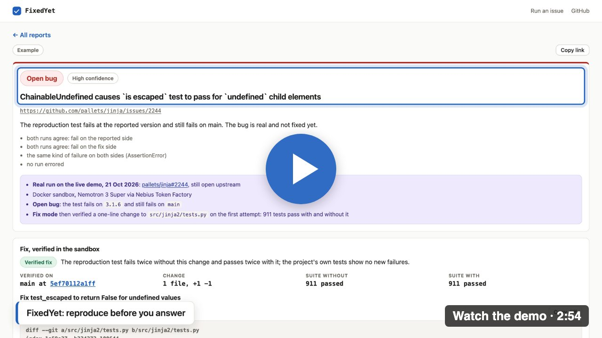
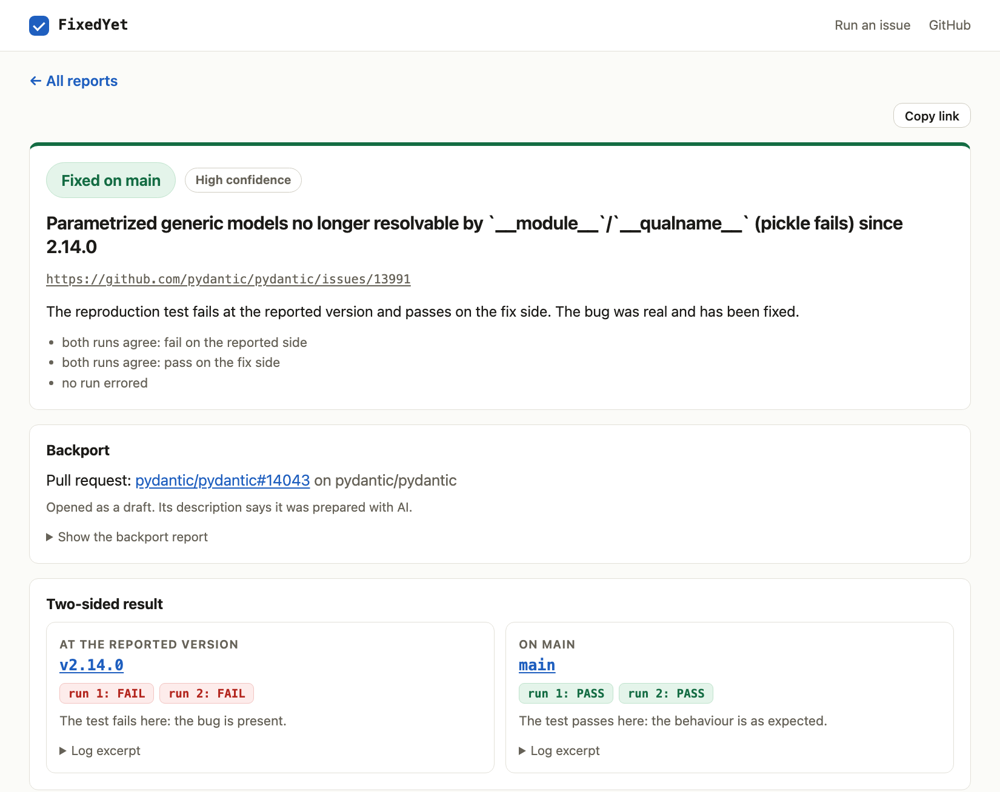
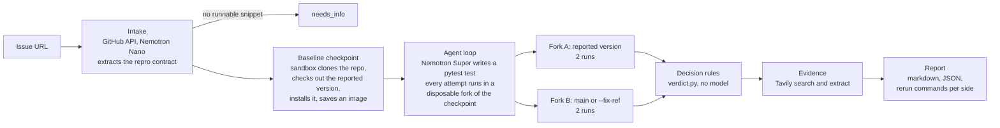

# FixedYet

*Is this bug fixed yet?* **Reproduce before you answer.** Give it a public GitHub issue. An agent on NVIDIA Nemotron writes a pytest test that should fail while the bug is present, runs it in a sandbox at the version the reporter used, runs the same test again on `main`, and returns a verdict with evidence. The sandbox decides the verdict, not the model. For a bug that is still open it can write the smallest fix and prove it; for a bug already fixed on `main` it can prove the backport to the reporter's release line.

Built for the Nebius x NVIDIA Global AI Hackathon 2026, Coding and Agentic Engineering track. MIT licensed.

[](https://www.youtube.com/watch?v=lB7mk7QRPWQ)

## For judges

- **Live demo:** https://fixedyet.benlevin.fyi/, and every saved report at https://fixedyet.benlevin.fyi/reports. **Video (2:54):** https://www.youtube.com/watch?v=lB7mk7QRPWQ
- **Start here:** the [jinja#2244 report](https://fixedyet.benlevin.fyi/reports#real-pallets-jinja-2244). An open bug, then a one-line fix that FixedYet verified in the sandbox (911 tests pass with and without it): the same check the jinja maintainer asked for in the open upstream pull request.
- **Run one yourself:** paste an issue from a pure-Python project tested with pytest. The judge code in the Devpost testing instructions gives judges their own daily runs.
- **Measured:** on SWE-bench Verified, the final agent reproduced **13, 12 and 11 of 15** issues in three full runs (36 of 45, 80%), and **14 of the 15** in at least one run, at **about $0.03 and 80 seconds per issue**. Ten recent real issues, rerun live on the demo with the same agent, gave **8 of 10** correct verdicts; the other 2 are flagged at low confidence with the reason, and none is wrong at high confidence. Every run, the misses and the development runs included, is in [Evaluation](#evaluation).
- **Upstream pull requests:** [psf/black#5578](https://github.com/psf/black/pull/5578) fixes an open Black bug: FixedYet reproduced it on `main` and Nemotron's fix was verified there; a review then made it the PEP 440 form and added test cases, and Black's own CI commands pass (596 tests, plus 83 in the Jupyter run), ready for review ([how it went](docs/fix-mode.md#psfblack5468-a-verified-fix-that-was-wrong-and-the-one-that-went-upstream), including a first verified fix that was wrong). [pydantic/pydantic#14043](https://github.com/pydantic/pydantic/pull/14043) is a backport FixedYet verified onto `v2.14-fixes` (6,250 tests, no new failure); the maintainer closed it unmerged on 22 October, as they do the backports themselves before a patch release. [nedbat/cog#98](https://github.com/nedbat/cog/pull/98) and [RDFLib/rdflib#3603](https://github.com/RDFLib/rdflib/pull/3603) start from FixedYet's reproductions and fixes, but were completed with Claude's help after FixedYet's first version, and the rdflib change needed a different approach after review.
- **NVIDIA and Nebius:** every model call is NVIDIA Nemotron on Nebius Token Factory, and the demo's code runs in Nebius Sandboxes; [where, and what it changed](#where-nemotron-and-token-factory-are-used).
- **Scope, plainly:** pure-Python projects tested with pytest. The results above ran on the Docker sandbox backend; since 22 October the demo runs on Nebius Sandboxes, where a [run of the same 15 SWE-bench issues](docs/evaluation.md#nebius-sandboxes-22-october-2026) reproduced 12.



## Why

Most bug reports get answered from memory, from the docs, or from a model that never ran the code. A maintainer needs two answers: does the bug exist at the version the reporter used, and is it already fixed on `main`? FixedYet answers both by running code, and hands over the commands that rerun each side at the commit it ran on.

- **Version-anchored.** A test that fails at the reported version and on `main` is an open bug. A test that fails at the reported version and passes on `main` is fixed, and the report names the fixing commit and release when it can.
- **Sandbox-decided.** The model proposes a test. A fixed decision matrix turns the run results into a verdict and a confidence level, and the model cannot override it. Each side runs twice to catch flaky tests.

## Where Nemotron and Token Factory are used

| Step | Model on Nebius Token Factory | Why this model |
|---|---|---|
| Intake: read the thread, extract version, setup, snippet, expected and observed behaviour | **Nemotron 3 Nano** (`nvidia/NVIDIA-Nemotron-3-Nano-30B-A3B`), Super as the fallback | a structured extraction, at $0.06 / $0.24 per million tokens |
| Write the reproduction test: a hand-written tool-calling loop that reads files, searches the code, runs scripts to see what the code returns, writes a test and runs pytest, each in a fork of the checkpoint | **Nemotron 3 Super** (`nvidia/nemotron-3-super-120b-a12b`), with reasoning | its long context holds the issue thread plus the source files the agent reads; about 15 calls a run. [Measured](docs/evaluation.md#model-choice-22-october-2026): Nano in its place reproduced 14 of 30 instance runs, against 36 of 45, at a third of the cost; Super without reasoning, 21 of 30 at the same cost |
| Root cause and next actions in the report | Nemotron 3 Super | labelled as unchecked model text |
| [Fix mode](docs/fix-mode.md): search/replace edits for an open bug | Nemotron 3 Super, with reasoning | up to 16,000 tokens and 420 s per call |
| The verdict | **no model** | `verdict.py`, a decision matrix over exit codes |

Other parts: **Tavily** search and extract find similar issues, upstream reports and the changelog entry of a fix; when no pull request names the fix, a `git bisect` in the sandbox finds the fixing commit. **Nebius Sandboxes** runs the demo's code: one checkpoint per repository and version, and every agent attempt and both verdict runs as forks of it (`sandbox/nebius.py`, on `contree-sdk`, the `[nebius]` extra). The backend was written before beta access came and ran unchanged when it did; on the demo it builds a project's baseline in 13 s, against about a minute in Docker on the demo's 1 GB VM ([measured](docs/evaluation.md#nebius-sandboxes-22-october-2026)). The **Docker backend** implements the same checkpoint-and-fork interface, ran the earlier results, and is the default for running FixedYet locally.

How Token Factory sped the work up:

- **An OpenAI-compatible endpoint.** The agent loop is the stock `openai` client with a different base URL: no SDK and no agent framework to learn, and Nano and Super sit behind the same client.
- **The price made measuring cheap.** A run averages about 90,000 input and 5,000 output tokens, about $0.03 at $0.30 / $0.90 per million for Super. A full 15-issue SWE-bench run cost $0.41 to $0.47, so the evaluation was run three times, and live issues were run again after each environment fix they exposed.
- **Fast enough for a live demo.** About 15 model calls a run fit in a mean wall time of 1.5 minutes per SWE-bench issue, sandbox time included.

## How it works



1. **Intake.** Fetch the issue and its comments; Nano extracts a repro contract. No runnable snippet means `needs_info`. Text a reader of the thread cannot see (HTML comments, invisible characters) never reaches the model.
2. **Baseline checkpoint.** The sandbox clones the repository, checks out the reported version, installs it with its own test dependencies, and saves an image ([details](docs/environment.md)).
3. **Write the test.** Super reads, searches and runs pytest; every attempt starts from the checkpoint, so failed attempts leave nothing behind.
4. **Run both sides.** Two forks run the same test twice each, at the reported version and on the fix side, as an unprivileged user.
5. **Decide** with the matrix below, then **gather evidence** with Tavily and **report** in markdown and JSON, with per-side rerun commands.

### Decision matrix

| Reported version | Fix side (main) | Verdict |
|---|---|---|
| test fails | test passes | `fixed_on_main` |
| test fails | test passes, but the reported version is not in main's history (released from another branch) | `fixed_on_main`, confidence low |
| test fails | test fails the same way (the same error text) | `open_bug` |
| test fails | test fails, different error or different error text | `inconsistent`, confidence low |
| test fails | test fails the same way, on an exception the issue never names | `open_bug`, confidence low |
| test fails | test fails the same way, and GitHub shows the issue closed as completed or a merged pull request that closes or mentions it | `open_bug`, confidence low |
| test passes | test passes | `not_reproduced` |
| test passes | test fails | `inconsistent` |
| setup or collection error, or the environment could not be built | any | `unsupported` |
| the issue has no runnable reproduction | not run | `needs_info` |
| runs disagree on either side | | `inconsistent`, confidence low |

An `inconsistent` result puts the test in doubt, not the code, so FixedYet then writes one more, independent test from the issue alone (nothing from the first attempt or the fix side reaches the model) and reports that second test's verdict, whatever it is, with the first test kept in the report.

## Quickstart

Python 3.12 or newer, and a running Docker daemon (Docker Desktop, or Colima on a Mac).

```bash
git clone https://github.com/beniamin-levin/fixedyet.git
cd fixedyet
python3.12 -m venv .venv && source .venv/bin/activate
pip install -e .            # add ".[dev]" for the tests

cp .env.example .env        # then fill in the keys, see below
fixedyet doctor            # checks keys, model access and the sandbox
fixedyet run https://github.com/OWNER/REPO/issues/123
```

| Variable | Needed for |
|---|---|
| `NEBIUS_API_KEY` | Token Factory inference, and Sandboxes unless `CONTREE_TOKEN` is set |
| `TAVILY_API_KEY` | evidence. Without it that step is skipped |
| `GITHUB_TOKEN` | optional for `run` (a read-only token lifts GitHub's 60 requests an hour); required for `--open-pr`, which also falls back to `gh auth token` |
| `FIXEDYET_SANDBOX` | `docker` (default) for the local Docker daemon, or `nebius` for Nebius Sandboxes: `pip install -e ".[nebius]"` and `NEBIUS_PROJECT_ID` |

Every variable is in [`.env.example`](.env.example). Sandboxes is a beta product, so access has to be requested from Nebius; Docker runs the same flow with no account.

```bash
fixedyet run URL --fix-ref v2.4.0     # fix side is a tag, branch or commit instead of main
fixedyet run URL --md report.md --json assessment.json
fixedyet backport URL                 # prove the fix on the maintenance branch (dry run)
fixedyet fix --from-assessment a.json # an open bug: the model writes a fix, the sandbox verifies it
fixedyet serve --port 8090            # the demo web app
fixedyet mcp                          # the MCP server on stdio
fixedyet gc                           # prune old Docker checkpoint images
```

## Use it from an AI assistant (MCP)

The MCP server exposes four tools:

| Tool | Returns |
|---|---|
| `reproduce_issue(issue_url, fix_ref=None)` | the markdown report followed by a JSON block with the full assessment |
| `check_fixed(issue_url, ref)` | `{"fixed": true/false/null, "verdict", "confidence", "summary"}` |
| `propose_backport(issue_url, target_branch=None)` | a dry run of a [verified backport](docs/backports.md): the markdown summary and a JSON block with the result |
| `propose_fix(issue_url)` | a dry run of [fix mode](docs/fix-mode.md): it reproduces the issue and, for an open bug, has the model write the smallest change and the sandbox verify it. Returns the reproduction verdict, the markdown summary and a JSON block with the result (status, diff, attempts, suite before and after) |

`fixed` is `true` when the bug reproduces at the reported version and not at `ref`, `false` when it still reproduces at `ref`, and `null` when that cannot be said. `propose_backport` and `propose_fix` never push and never open a pull request; the MCP server does not import the pull request code at all.

```bash
claude mcp add fixedyet -- /path/to/fixedyet/.venv/bin/fixedyet mcp
```

Any other MCP client takes the same command as a stdio server, with `NEBIUS_API_KEY` and `TAVILY_API_KEY` in its environment. A run takes a few minutes and spends credits, so the assistant should call the tools on purpose.

## Evidence and the fixing commit

After the verdict, Tavily and GitHub look for reports of the same bug, the fix and the release that ships it. A web hit is kept only when it cites the issue or names the issue's own identifiers (`host_is_trusted`, `validate.Email`, the class the title quotes), with stricter rules the further it is from the project: on the 13 saved live reports the evidence went from 68 items with 43 noise (a company called Marshmallow, a blog post, an unrelated CVE, four unrelated pull requests) to 31 items with 1, for 2 more Tavily credits in all. A same-repository issue is a "similar issue" unless the thread calls it a duplicate. The release comes from the project's own changelog first, then its release notes.

When the bug is fixed on `main` but no merged pull request references the issue, `git bisect run` finds the fixing commit in the sandbox, offline, with the reproduction test, at most 12 steps; only a commit the test confirms (fails at its parent, passes at it) is recorded, so that it can be backported. On werkzeug#3312 it found the merge that brought the fix to `main` in 5 test runs, and named the commit a maintainer had pointed to as its first candidate. Details and the measurement in [docs/evidence.md](docs/evidence.md).

## Verified backports (draft PRs)

A bug fixed on `main` is still broken for everyone on the release they use. `fixedyet backport` cherry-picks the fixing commit (from the merged pull request, or [found by bisecting](docs/evidence.md#finding-the-fixing-commit-by-bisecting)) onto the maintenance branch of the reported version and proves it there: the reproduction test must fail before and pass after, and the project's own suite must show no new failure. Conflicts stop it; the model never resolves them. `--open-pr` opens a **draft** pull request in your fork, or on the upstream project after you type its name, and the body says it was prepared with AI.

Two real cases: [pytest-dev/pytest#13784](https://github.com/pytest-dev/pytest/issues/13784) (a draft in the owner's fork) and [pydantic/pydantic#13991](https://github.com/pydantic/pydantic/issues/13991), which went upstream after a human review as [pydantic/pydantic#14043](https://github.com/pydantic/pydantic/pull/14043) (closed unmerged: the maintainer does the backports). The gates, the statuses and the pull request rules are in [docs/backports.md](docs/backports.md).

## Fix mode: open bugs to verified draft PRs

For an open bug, `fixedyet fix` asks Nemotron 3 Super for the smallest change that makes the reproduction test pass, and accepts nothing it has not proved in the sandbox: the test fails twice without the change and passes twice with it, and the project's suite has no newly failing test. The model sees a few source files, answers with search/replace blocks (never a test, CI or packaging file, at most 80 lines), and gets up to 3 attempts within `FIXEDYET_FIX_BUDGET_USD`. The result also lists the other callers of the changed code, which the test does not cover.

On [psf/black#5468](https://github.com/psf/black/issues/5468) it reproduced the bug on `main` and verified a fix on the first attempt for $0.009, which went upstream as [psf/black#5578](https://github.com/psf/black/pull/5578) after a review. The first verified fix there was wrong for an input the issue named and the test did not check, which is why the agent now asserts every failing input an issue names. On the live demo it verified [pallets/jinja#2244](https://github.com/pallets/jinja/issues/2244) on the first attempt, with the same check the open upstream pull request [pallets/jinja#2259](https://github.com/pallets/jinja/pull/2259) makes after the maintainer's review; no pull request was opened, because it would duplicate that one. Every live run, the misses included, is in [docs/fix-mode.md](docs/fix-mode.md).

## Web demo

https://fixedyet.benlevin.fyi/ runs the same pipeline behind a small FastAPI app: paste an issue URL, watch the stages live, read the report. One run at a time, a public daily limit, judge codes with their own quota, and a check that the repository is Python before a run is counted. The reports page lists every run, one row per issue, and shows a report's verdict first, then its fix or backport. The maintainer verifies backports and fixes and opens draft pull requests from it. Details in [docs/web-demo.md](docs/web-demo.md); deployment in [`deploy/`](deploy/README.md).

## Evaluation

The claim "reproduce before you answer" is only worth something if it is measured. The evaluation uses SWE-bench Verified: the base commit plays the reported version, the base commit plus the gold patch plays `main`, and the agent never sees the patch or SWE-bench's own tests. An instance counts as reproduced when the agent's own test fails at the base commit and passes with the patch, in every run.

**Measured on 2026-10-22, on the final agent (commit `f2b8ad7`): 13, 12 and 11 of 15 instances reproduced in three full runs** (87%, 80% and 73%; 36 of 45 instance runs, 80%, 95% interval 66-89%). **14 of the 15** were reproduced in at least one of the three runs; pylint-4970 never was. The 15 instances (`eval/instances.txt`) come from light pure-Python projects (requests, pytest, pylint, Flask) whose fixing pull requests date from 2014 to 2023. All runs used Nemotron 3 Super with Nemotron 3 Nano for intake and a **local Docker sandbox** (Colima on an Apple-silicon Mac). The live demo uses the same Docker backend on a 1 GB Oracle Cloud VM.

| Metric | Run F1 | Run F2 | Run F3 |
|---|---|---|---|
| Reproduction rate (`fixed_on_main`) | 13/15 (86.7%) | 12/15 (80.0%) | 11/15 (73.3%) |
| Wrong open bug (`open_bug`), of which high confidence | 0, 0 | 1, 1 | 2, 2 |
| Not reproduced rate | 1/15 | 2/15 | 2/15 |
| Inconsistent rate | 0/15 | 0/15 | 0/15 |
| Setup failure rate (`unsupported`) | 1/15 | 0/15 | 0/15 |
| Needs-info rate | 0/15 | 0/15 | 0/15 |
| Mean / median cost per issue | $0.032 / $0.025 | $0.041 / $0.043 | $0.026 / $0.021 |
| Mean wall time per issue | 1m43s | 1m11s | 1m01s |
| Total cost of the run | $0.48 | $0.62 | $0.38 |

Earlier agents, for comparison: runs A and B (rules v1, 21 October) reproduced 12 and 10, run C (rules v2) 11; six runs on two intermediate agents of 22 October reproduced 9 to 11, and they are listed with the reason each was replaced. The agent changes since run C each came from a miss in these runs or from a showcase fix, so the same 15 issues motivated and measured them: this is **not a held-out score**. The live check on recent issues and the psf/black fix are the out-of-sample evidence.

What went wrong, plainly: **the misses are the model's tests, not the environment.** In the final runs the misses were a test that asks for more than the fix delivers (three wrong `open_bug`, all at high confidence), a test that never triggers the bug (`not_reproduced`, pylint-4970 every time) and one test naming a class that does not exist. An `inconsistent` first test now gets one more, independent test, which removed the `inconsistent` results. In runs A and B every wrong verdict was an `open_bug` from a test that fails on both sides for its own reason: it asked for more than the fix delivers, had a wrong expectation or called an API that does not exist. Rules v2 reads that from the two logs, with no model: a failure whose text changes between the sides is `inconsistent`, an exception the issue never names lowers the confidence, and so does an issue GitHub shows as closed as completed or closed by a merged pull request. The agent is also told when its own test fails for the wrong reason. Re-scoring the saved runs with no model call cut the wrong open bugs at high confidence from 3 to 1 (run A) and from 4 to 2 (run B); in two more runs of the seven instances that had ever come out `open_bug`, 2 and 1 remained. Those that remain (pylint-6528, requests-2317) fail the same way on both sides with an assertion, which no rule over two logs can tell from a real open bug. `fixedyet rescore` applies the rules to saved reports; the numbers, the per-instance history and the limits are in [`docs/evaluation.md`](docs/evaluation.md#results-rules-v2).

What the numbers do not say:

- **Contamination.** Nemotron may have seen these public issues and their fixes during training, and several reproduced tests are the issue's own snippet. The score partly measures recall. The live check on ten recent real issues (none from SWE-bench, opened July to October 2026) gave **8 correct verdicts out of 10** after two environment fixes it exposed (6 of 10 before them), and 8 of 10 again on the final agent: the other two are flagged at low confidence (pytest-mock#639 `inconsistent`; pyparsing#693 passes on master because its 3.3.3 release came from a branch master never merged, which the report now says). Four controls on real open bugs keep `open_bug` under rules v2 (jinja#2244, dateutil#1588 and marshmallow#3072 at high confidence; click#2827 at low, because it was closed by an opt-in pull request). The table is in [`docs/evaluation.md`](docs/evaluation.md#live-check-on-real-issues).
- **Small sample, noisy model.** One instance is 6.7 points, and runs on the same agent differ by two instances.
- **`fixed_on_main` is necessary, not sufficient.** The 33 reproduced tests of runs A, B and C were read against their issues; that audit was done by an AI (Claude), not a person: all exercise the reported behaviour, with a few weaknesses (one calls a live server, one passes if nothing raises). A person has not audited them, and the reproductions of the final runs have not been read.

The per-instance verdicts, costs and failure causes, the metric definitions, the audit and how to rerun are in [`docs/evaluation.md`](docs/evaluation.md). The raw results are in `eval/results/`.

## Cost per issue

Measured: **$0.033 on average and $0.025 at the median** per issue at Token Factory list prices, over the 45 instance runs of the final agent; the ten live issues cost $0.15 together, plus a few Tavily credits each. A run that passes `FIXEDYET_RUN_BUDGET_USD` (default $0.60) stops without a verdict rather than guessing. Token Factory has no spending limit, so `FIXEDYET_TOTAL_BUDGET_USD` (default $20) caps the model spend of all runs ever: every call is checked against a spend ledger before it is sent. Fix mode has its own cap per fix, `FIXEDYET_FIX_BUDGET_USD` (default $0.25).

## Limitations

- **Pure-Python projects that test with pytest.** That is what the environment builder installs and what the verdict runs.
- **No services or databases.** An issue that needs a running database, a message broker or a browser is reported as `unsupported`, not guessed at.
- **Old versions can fail to install.** Setup failures are their own verdict and their own metric.
- **A failing test is not proof of the reported bug.** The model can write a test that fails for another reason. Two runs per side, the `inconsistent` verdict and the rules v2 checks reduce this, but a test that fails the same way on both sides for its own reason still reads as an open bug, so a person should read the test.
- **A verified fix is not a reviewed fix.** On psf/black#5468 the first fix passed the reproduction test and all of Black's tests, and was still wrong for an input the issue named. Fix mode shows what its checks cover and what they do not (the other callers of the changed code); read the diff before opening anything.
- **"Fixed on main" needs main to have had the bug.** A release cut from its own branch can carry a regression main never had; FixedYet checks that the reported commit is in main's history and says so when it is not.
- **Training contamination.** Nemotron may have seen SWE-bench issues and their fixes; the live runs on recent issues are the check against it.
- **Most measurements ran on Docker.** The three SWE-bench runs, the ten live issues and the fix and backport cases came from the Docker backend; Nebius Sandboxes has one SWE-bench run and [the checks of 22 October](docs/evaluation.md#nebius-sandboxes-22-october-2026). There, a large test suite ran about 2.4 times slower than on a laptop's Docker, so fix and backport mode take longer on the demo.

## Prior art and how this differs

- **Metabase Repro-Bot** (MIT) checks a bug at the reported version and on `master`, but only for Metabase, lets the model decide the verdict and forbids web search. FixedYet is generic across pure-Python projects, lets rules decide, and adds web evidence.
- **SWE-agent, mini-swe-agent, OpenHands** and the commercial coding agents go straight to a fix; reproduction is at most a step in their prompts. FixedYet's main output is the proof, and its fix mode only runs on a bug the sandbox has shown to be open.
- **The OpenAI, Vercel and Daytona reference triage agents** run code against the default branch only and let the model judge the result.
- **SWT-bench** (Mündler et al., NeurIPS 2024) is the benchmark for this task: write a test from an issue that fails before the fix and passes after it. The evaluation below uses the same fail-to-pass criterion on SWE-bench Verified, but on 15 instances, so its numbers are not comparable to the SWT-bench leaderboard.

## Safety

- **Issue text and web content are untrusted data.** Every prompt says so, and what GitHub hides from readers is stripped before the model sees the thread.
- **Code runs only in sandboxes,** without network for the tests, as an unprivileged user. That includes the two runs per side that decide the verdict: a side that checks out another ref installs it first in a separate sandbox run with network, then tests offline. The host never runs code from an issue or from the model; fix mode checks the model's edits on the host as text only.
- **It never posts on other people's repositories by default.** The only write paths are `--open-pr` and the demo's maintainer buttons: a draft pull request in the token owner's fork, or upstream only after the person types the repository's name. Nothing comments on an issue.
- **Secrets stay in the environment,** masked when settings are printed and never returned by the web API or the MCP server.
- **The demo is rate limited:** one run at a time, daily quotas and a total budget.

## Code and development

The module map and the public interfaces are in [docs/architecture.md](docs/architecture.md). Development: `pip install -e ".[dev]"`, then `python -m pytest` and `ruff check src tests`. Tests never call a paid API.

## Licence

MIT, see [LICENSE](LICENSE).
